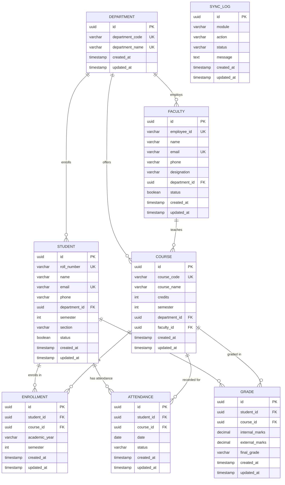

# Entity Relationship Diagram

## Overview

This diagram describes the ERP database for the LMS–ERP Integration Platform.
The ERP is the source of truth. Moodle data is synchronized from the ERP in a
future sprint and is **not** part of this schema.

See [docs/DATABASE.md](DATABASE.md) for the full column, constraint, and index
specification.

---

## Mermaid ER Diagram

---

## Cardinality Legend

| Symbol  | Meaning                          |
|---------|----------------------------------|
| `||`    | exactly one                     |
| `o{`    | zero or many                    |
| `o|`    | zero or one                     |
| `{`     | one or many                     |

Examples:

- `DEPARTMENT ||--o{ FACULTY` — a department employs zero or many faculty; each faculty member belongs to exactly one department.
- `STUDENT ||--o{ ENROLLMENT` — a student has zero or many enrollments; each enrollment belongs to exactly one student.
- `COURSE ||--o{ ENROLLMENT` — a course has zero or many enrollments; each enrollment is for exactly one course.

---

## Relationship Summary

| Relationship                          | Type        | Foreign Key                        |
|---------------------------------------|-------------|------------------------------------|
| Department → Faculty                  | 1 : N       | `faculty.department_id`            |
| Department → Student                  | 1 : N       | `students.department_id`           |
| Department → Course                   | 1 : N       | `courses.department_id`            |
| Faculty → Course                      | 1 : N       | `courses.faculty_id` (nullable)    |
| Student ↔ Course (via Enrollment)     | M : N       | `enrollments.student_id`, `enrollments.course_id` |
| Student → Attendance                  | 1 : N       | `attendance.student_id`            |
| Course → Attendance                   | 1 : N       | `attendance.course_id`             |
| Student → Grade                       | 1 : N       | `grades.student_id`                |
| Course → Grade                        | 1 : N       | `grades.course_id`                 |
| Sync Log                              | standalone  | (no foreign keys)                  |

---

## Notes

- `SyncLog` intentionally has no relationships; it records generic synchronization events for any entity type.
- No `users` table exists yet. It will be introduced with the Authentication module in a future sprint.
